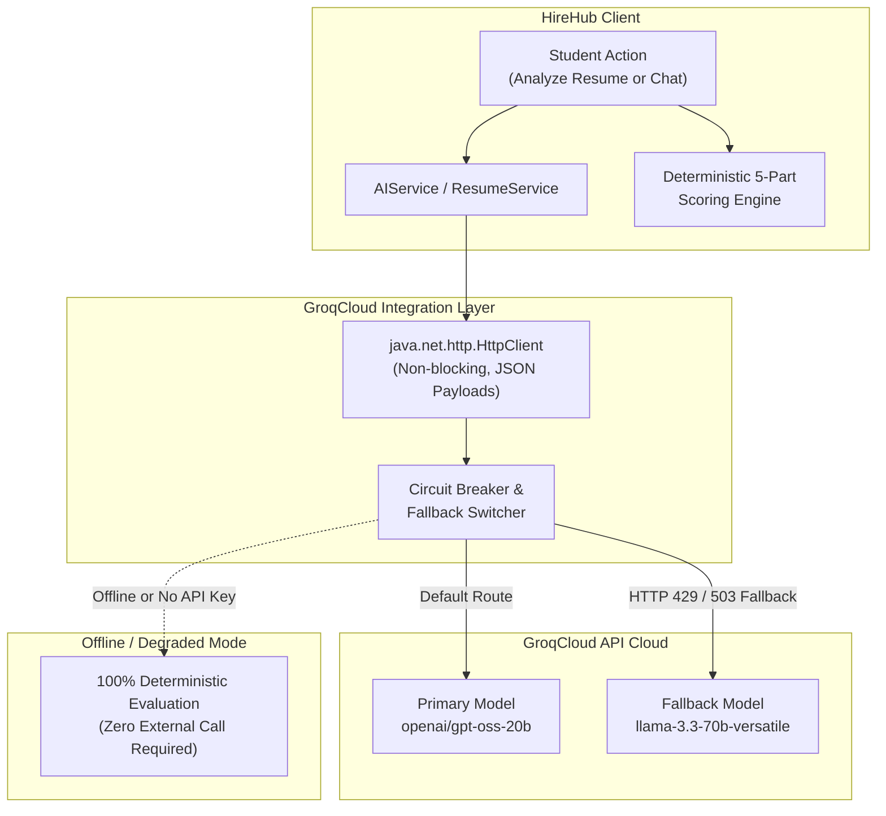

# HireHub — AI Integration & Scoring Rubric Specification

This document details the AI architecture, GroqCloud API integration, and the deterministic resume evaluation engine within the **HireHub** platform.

---

## 1. AI Integration Architecture

HireHub utilizes **GroqCloud API** for low-latency Large Language Model (LLM) inference, integrated through a lightweight, zero-dependency client using Java 21's native `java.net.http.HttpClient` and `com.google.gson.Gson`.



---

## 2. Model Hierarchy & Configuration

| Role | Model ID | Context / Architecture | Characteristics |
| :--- | :--- | :--- | :--- |
| **Primary Model** | `openai/gpt-oss-20b` | Structured JSON extraction & career chat | Fast time-to-first-token (<300ms on Groq LPUs), precise JSON compliance |
| **Fallback Model** | `llama-3.3-70b-versatile` | High-complexity reasoning | Activated automatically on HTTP 429 (rate limit) or 503 (overload) |

Configuration is supplied via environment variables:
```bash
GROQ_API_KEY=gsk_...
GROQ_MODEL=openai/gpt-oss-20b                 # Optional override
GROQ_FALLBACK_MODEL=llama-3.3-70b-versatile    # Optional override
```

---

## 3. Hybrid Resume Scoring Architecture

HireHub implements a **hybrid evaluation model** combining a rigorous deterministic scoring engine with qualitative AI feedback.

### 3.1. Deterministic 5-Part Scoring Rubric (100 Points Total)

The deterministic engine ensures reproducible, bias-free numerical scores regardless of AI network availability:

```
Total Match Score (0 - 100%) =
    Technical Skills (40 pts)
  + Experience & Projects (25 pts)
  + Education Alignment (15 pts)
  + Profile Completeness (10 pts)
  + Certifications & Credentials (10 pts)
```

| Component | Max Points | Evaluation Heuristics |
| :--- | :---: | :--- |
| **1. Technical Skills** | **40** | Exact and semantic keyword matching against required skills in the job specification. When running in General Review mode, evaluates technical breadth across detected modern programming languages, frameworks, and databases. |
| **2. Experience & Impact** | **25** | Detects work history items, internship durations, completed projects, and quantifiable impact metrics (percentages, numbers, performance multipliers). |
| **3. Education** | **15** | Analyzes degree level (B.Tech, M.Tech, MCA, etc.), academic institution, and graduation year alignment. |
| **4. Completeness** | **10** | Verifies presence of complete contact details (phone, email), professional links (GitHub, LinkedIn), and standard resume section headers. |
| **5. Certifications** | **10** | Identifies listed industry credentials and certifications. **Mandatory Policy**: Evaluated with an explicit unverified disclaimer (*"Found X detected credential(s). Note: Listed credentials have not been independently verified."*). |

### 3.2. Fair Scoring & Unevaluated Criteria Handling
To ensure fairness for early-career students:
- Omitted optional sections are marked as `unevaluated` rather than applying punitive negative scores.
- Resumes with sparse data adjust the **Evaluation Confidence** metric (`HIGH`, `MEDIUM`, `LOW`) rather than arbitrarily failing the candidate.

### 3.3. Dual Review Modes
1. **Targeted Job Evaluation (`job_id != null`)**: Computes role compatibility percentage, matching skills, and missing skills required for the specific job posting.
2. **General Resume Review (`job_id == null`)**: Evaluates overall resume strength, formatting quality, and technical breadth across current industry standards.

---

## 4. AI Career Assistant

The AI Career Assistant provides conversational guidance within the Student Workspace:
- **Interactive Chat**: Provides placement preparation advice, mock interview question generation, and tailored skill development plans.
- **Context Preservation**: Retains the student's profile skills and graduation goals in the prompt context.
- **Safety & Moderation**: Adheres to system safety guidelines and rejects inappropriate queries gracefully.

---

## 5. Resilience & Fault Tolerance Guarantees

1. **Zero Crash Guarantee**: Under no circumstances will network timeouts, bad HTTP status codes, or malformed JSON crash the JavaFX desktop client.
2. **Offline Fallback**: When `GROQ_API_KEY` is not present, the Resume Analyzer automatically performs complete PDF parsing and deterministic scoring, notifying the user that AI qualitative commentary is disabled.
3. **Automatic Model Failover**: On HTTP 429 (rate limit exceeded) or HTTP 503 (model overloaded), the client automatically retries the request using the fallback model (`llama-3.3-70b-versatile`).
4. **Safety Filter Interception**: If Groq returns a `content_filter` block, the system displays user-friendly guidance rather than a raw exception.
