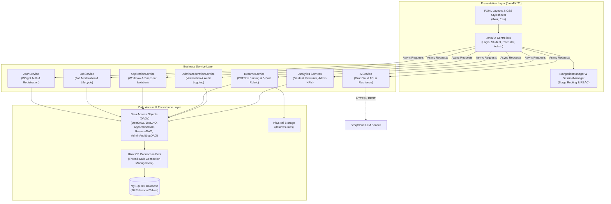
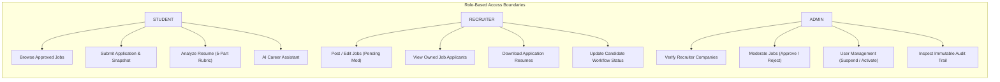

# HireHub — Architecture & Design Specification

This document provides a comprehensive architectural overview of the **HireHub** Campus Placement & Recruitment Management Platform.

---

## 1. Architectural Philosophy

HireHub is built upon enterprise software engineering principles for desktop applications:
- **Layered Decoupling**: Strict separation of concerns across Presentation (FXML/Controllers), Business Logic (Services), and Data Access (DAOs).
- **Fail-Closed Security**: All state-modifying actions and UI views perform mandatory session role and ownership validation prior to execution.
- **Asynchronous UI Responsiveness**: Heavy operations (database queries, PDF parsing, AI network calls) run on background worker threads, keeping the JavaFX Application Thread non-blocking.
- **Deterministic Analytics**: Metrics, pipeline funnels, and scoring algorithms are deterministically derived from live transactional database records.

---

## 2. High-Level System Architecture

HireHub employs an enterprise **3-Tier MVC Architecture** complemented by dedicated Service and Data Access layers:

---

## 3. Layer Breakdown

### 3.1. Presentation Layer (JavaFX 21 + FXML + CSS)
- **View Templates (`/src/main/resources/fxml/`)**: Declarative UI layout trees defined in FXML.
- **Design System (`/src/main/resources/css/style.css`)**: Centralized design system matching the approved Figma Make specifications. Features navy sidebars (`#0F1E36`), primary blue accent controls (`#1E40AF` / `#2563EB`), crisp neutral borders (`#E2E8F0`), and clean metric cards.
- **Controllers (`com.hirehub.controller`)**: Manage UI event handling, control bindings, and model-to-view population.
  - `LoginController` / `RegisterController`: Handles authentication, role switching, input validation, and password masking.
  - `StudentDashboardController`: Student metrics, application activity timeline, pipeline visualization, and job recommendations.
  - `BrowseJobsController` / `MyApplicationsController`: Student job searching and application status tracking.
  - `ResumeAnalyzerController`: Resume PDF drag-and-drop/upload, scoring rubric breakdown visualization, and AI recommendations.
  - `AICareerAssistantController`: Interactive chat interface with GroqCloud AI.
  - `RecruiterDashboardController` / `JobManagementController` / `PostJobController`: Recruiter job creation, editing, closing, and candidate funnel tracking.
  - `ApplicantManagementController`: Recruiter candidate review and progression stages.
  - `AdminDashboardController` / `AdminUserManagementController` / `AdminModerationController`: Administrative oversight, recruiter verification, job moderation, and audit logs.

### 3.2. Business Service Layer (`com.hirehub.service`)
Encapsulates all business rules, transactional logic, and security checks:
- **`AuthService`**: Authenticates users against BCrypt password hashes, validates password complexity, and registers students and recruiters.
- **`JobService`**: Manages job lifecycles (`ACTIVE`, `CLOSED`, `DRAFT`) and moderation statuses (`APPROVED`, `PENDING`, `REJECTED`, `SUSPENDED`).
- **`ApplicationService`**: Validates student eligibility, prevents duplicate submissions, links submitted resume IDs (`applications.resume_id`), and updates application statuses (`PENDING`, `SHORTLISTED`, `REJECTED`, `SELECTED`).
- **`ResumeService`**: Coordinates PDF text extraction via Apache PDFBox, executes the deterministic 5-part scoring engine, and handles resume persistence.
- **`AIService`**: Interfaces with GroqCloud API for qualitative resume evaluation and career guidance with built-in model fallbacks.
- **`AdminModerationService`**: Manages administrative workflows (approving/rejecting jobs, verifying recruiters, suspending accounts) and records immutable entries in `admin_audit_logs`.
- **`StudentAnalyticsService`, `RecruiterAnalyticsService`, `AdminAnalyticsService`**: Compute real-time dashboard KPIs, placement readiness scores, and activity timelines directly from transactional data.

### 3.3. Data Access Layer (`com.hirehub.dao` & `com.hirehub.database`)
- **DAO Pattern**: Every domain entity has a corresponding DAO (`UserDAO`, `JobDAO`, `ApplicationDAO`, `ResumeDAO`, `ResumeAnalysisDAO`, `AdminAuditLogDAO`).
- **PreparedStatement Only**: All SQL queries use parameterized PreparedStatements to guarantee protection against SQL injection attacks.
- **HikariCP Connection Pool (`DatabaseConnection.java`)**: High-performance connection pooling configured with:
  - Minimum idle connections: 2
  - Maximum pool size: 10
  - Connection timeout: 30,000 ms (30 seconds)
  - Validation timeout: 5,000 ms (5 seconds)
  - Idle timeout: 600,000 ms (10 minutes)
  - Max lifetime: 1,800,000 ms (30 minutes)
  - JVM Runtime Shutdown Hook: Automatically closes open pool connections on application exit.

---

## 4. Cross-Cutting Concerns

### 4.1. Security Architecture & RBAC
HireHub implements strict Role-Based Access Control (RBAC) across three principal roles: `STUDENT`, `RECRUITER`, and `ADMIN`.

- **Fail-Closed Session Guarding**: `SessionManager.getInstance().getCurrentUser()` is queried at every controller `initialize()` and service method invocation. If the user session is missing or the role does not match, execution fails closed and the user is redirected to the login stage.
- **Recruiter Isolation**: Recruiters can only query and modify jobs, applicants, and metrics belonging to their own `recruiter_id`. Cross-tenant data leaks are impossible at the DAO layer.
- **Resume Snapshot & Access Protection**: When a student submits an application, the active resume's ID is stored in `applications.resume_id` with an `ON DELETE RESTRICT` foreign key constraint. The student cannot delete a resume once referenced by an application (`isResumeReferencedByApplication` check and database FK constraint). Uploading a replacement resume creates a new record in `resumes` and marks it active, ensuring historical applications remain permanently linked to the exact resume submitted without file duplication.
- **Password Security**: Standardized on BCrypt with cost factor 12. No plain-text passwords exist anywhere in memory, database, or logs.

---

### 4.2. Concurrency & Threading Model
To guarantee 60 FPS desktop responsiveness:
1. **JavaFX Application Thread Isolation**:
   - The UI thread is dedicated strictly to rendering and user interaction.
   - Long-running network or database calls are prohibited from running synchronously on the JavaFX Application Thread.
2. **Background Execution**:
   - Background tasks utilize daemon worker threads or standard `Thread` instances with descriptive thread names (e.g. `[load-profile-thread]`, `[ai-query-thread]`).
   - Results are marshaled back to the UI thread using `Platform.runLater(() -> { ... })`.
3. **Atomic Remoderation Guarding**:
   - When a recruiter edits an already approved job, the update is executed as an atomic database transaction that updates the job details and reverts `moderation_status` to `'PENDING'` simultaneously, preventing unreviewed content from remaining live.

---

### 4.3. AI Resilience & Circuit Breaking
The AI subsystem integrates with GroqCloud API through a resilient zero-dependency HTTP client (`java.net.http.HttpClient`):
- **Model Fallback**:
  - Primary Model: `openai/gpt-oss-20b` (low latency, high reasoning fidelity).
  - Fallback Model: `llama-3.3-70b-versatile` (automatically selected if the primary model returns HTTP 429 or 503).
- **Offline / Degraded Operation**:
  - If no `GROQ_API_KEY` is configured, or if the user is offline, the Resume Analyzer seamlessly executes the **deterministic 5-part scoring engine** without interruption.
  - The UI gracefully indicates AI features are offline while displaying 100% accurate deterministic scoring and rule-based feedback.
