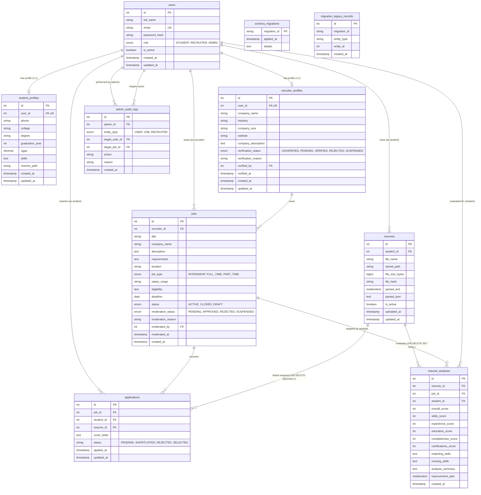

# HireHub — Database Schema & Migration Specification

This document details the database architecture, schema definitions, entity relationships, and migration procedures for the **HireHub** relational database (`hirehub_db`) running on MySQL 8.0.

---

## 1. Overview & Storage Engine Standards

- **Database Engine**: MySQL 8.0+
- **Default Storage Engine**: `InnoDB` (enforces ACID compliance, foreign keys, and row-level locking)
- **Character Set**: `utf8mb4`
- **Collation**: `utf8mb4_unicode_ci`
- **Connection Management**: HikariCP connection pool (`com.zaxxer.hikari.HikariDataSource`) configured via `DatabaseConnection.java`

---

## 2. Entity-Relationship (ER) Diagram



---

## 3. Schema Specifications (10 Tables)

### 3.1. `users`
Central identity store supporting multi-tenant role-based authentication.
- **Indexes**: `PRIMARY (id)`, `UNIQUE (email)`, `INDEX (role)`, `INDEX (is_active)`.
- **BCrypt Security**: `password_hash` stores standard 60-character BCrypt hashes with salt (cost factor 12).

### 3.2. `student_profiles`
Academic background, contact details, and core technical skills.
- **Foreign Key**: `user_id -> users(id) ON DELETE CASCADE`.

### 3.3. `recruiter_profiles`
Corporate organization metadata and verification status.
- **Foreign Key**: `user_id -> users(id) ON DELETE CASCADE`.
- **Foreign Key**: `verified_by -> users(id) ON DELETE SET NULL`.
- **Verification Enum**: `'UNVERIFIED'`, `'PENDING'`, `'VERIFIED'`, `'REJECTED'`, `'SUSPENDED'`.

### 3.4. `jobs`
Campus job postings, requirements, deadlines, and moderation lifecycle.
- **Foreign Key**: `recruiter_id -> users(id) ON DELETE CASCADE`.
- **Foreign Key**: `moderated_by -> users(id) ON DELETE SET NULL`.
- **Moderation Enum**: `'PENDING'`, `'APPROVED'`, `'REJECTED'`, `'SUSPENDED'`.
- **Lifecycle Enum**: `'ACTIVE'`, `'CLOSED'`, `'DRAFT'`.
- **Job Types**: `'INTERNSHIP'`, `'FULL_TIME'`, `'PART_TIME'`.

### 3.5. `resumes`
Physical resume files uploaded by students and structured parsing cache.
- **Foreign Key**: `student_id -> users(id) ON DELETE CASCADE`.
- **Tracking**: `is_active` marks the currently active resume. `file_hash` prevents redundant parsing.

### 3.6. `applications`
Student job applications and hiring pipeline stage progression.
- **Foreign Key**: `job_id -> jobs(id) ON DELETE CASCADE`.
- **Foreign Key**: `student_id -> users(id) ON DELETE CASCADE`.
- **Foreign Key**: `resume_id -> resumes(id) ON DELETE RESTRICT`.
- **Unique Constraint**: `UNIQUE (job_id, student_id)` prevents duplicate submissions.
- **Workflow Statuses**: `PENDING`, `SHORTLISTED`, `REJECTED`, `SELECTED`.

### 3.7. Resume Snapshot Implementation
HireHub ensures historical applications remain permanently linked to the exact resume submitted without duplicating physical files:
- When an application is submitted, `applications.resume_id` captures the student's active resume ID.
- The foreign key constraint `fk_app_resume` is defined with `ON DELETE RESTRICT ON UPDATE CASCADE`.
- The service layer (`ResumeService.deleteResume`) checks `isResumeReferencedByApplication` and forbids deleting any resume that has been used in an application.
- When a student uploads a new resume, the new file is stored with a unique ID and marked `is_active = true`. The previously submitted resume remains in `resumes` with `is_active = false`, ensuring existing applications continue referencing their original resume.
- Recruiters access the candidate's resume via `ApplicationService.getResumeForApplication(applicationId)` which securely resolves the resume file through `ResumeDAO.findResumeForApplicationAndRecruiter(applicationId, recruiterId)`.

### 3.8. `resume_analyses`
Structured results from deterministic 5-part scoring and Groq AI qualitative evaluation.
- **Foreign Key**: `resume_id -> resumes(id) ON DELETE SET NULL`.
- **Foreign Key**: `job_id -> jobs(id) ON DELETE SET NULL` *(NULL indicates general resume review without a specific target job)*.
- **Foreign Key**: `student_id -> users(id) ON DELETE CASCADE`.

### 3.9. `admin_audit_logs`
Disciplinary and moderation audit trail.
- **Foreign Key**: `admin_id -> users(id) ON DELETE RESTRICT`.
- **Foreign Key**: `target_user_id -> users(id) ON DELETE SET NULL`.
- **Foreign Key**: `target_job_id -> jobs(id) ON DELETE SET NULL`.
- **Immutability Guarantee**: Audit history is never deleted when a user or job is deleted.

### 3.10. `schema_migrations` & `migration_legacy_records`
Tracks applied database version migrations and persistent snapshots of legacy grandfathered records.

---

## 4. Safe Topological Initialization Order

When creating the database on a fresh system, tables must be created in topological foreign-key order to resolve dependencies cleanly without `ERROR 1824 (HY000)`:

1. `users` (No dependencies)
2. `schema_migrations` (No dependencies)
3. `migration_legacy_records` (No dependencies)
4. `student_profiles` (Depends on `users`)
5. `recruiter_profiles` (Depends on `users`)
6. `jobs` (Depends on `users`)
7. `resumes` (Depends on `users`)
8. `applications` (Depends on `jobs`, `users`, `resumes`)
9. `resume_analyses` (Depends on `resumes`, `jobs`, `users`)
10. `admin_audit_logs` (Depends on `users`, `jobs`)

Both `database/schema/ensure_all_tables.sql` and the sequential migrations in `database/migrations/` strictly follow this topological ordering.

---

## 5. Step-by-Step Database Setup

### Fast Setup (Single Script)
To initialize all 10 tables on a fresh MySQL instance:

```powershell
# 1. Create database
mysql -u root -p -e "CREATE DATABASE IF NOT EXISTS hirehub_db CHARACTER SET utf8mb4 COLLATE utf8mb4_unicode_ci;"

# 2. Execute idempotent table creation
mysql -u root -p hirehub_db < database/schema/ensure_all_tables.sql

# 3. Seed initial administrator account
mysql -u root -p hirehub_db < database/seed/admin_seed.sql
```

### Versioned Migration Setup (Sequential)
To apply each versioned migration sequentially:

```powershell
$migrations = @(
    "V1__init_schema.sql",
    "V2__profiles_and_jobs.sql",
    "V3__applications.sql",
    "V4__resumes_and_analyses.sql",
    "V4_1__resume_analyses_retention.sql",
    "V6_2__application_resume_snapshot.sql",
    "V6_4_1__admin_user_management.sql",
    "V6_4_2__recruiter_verification_and_job_moderation.sql"
)

foreach ($m in $migrations) {
    Write-Host "Applying migration: $m" -ForegroundColor Cyan
    Get-Content "database/migrations/$m" | mysql -u root -p hirehub_db
}
```
