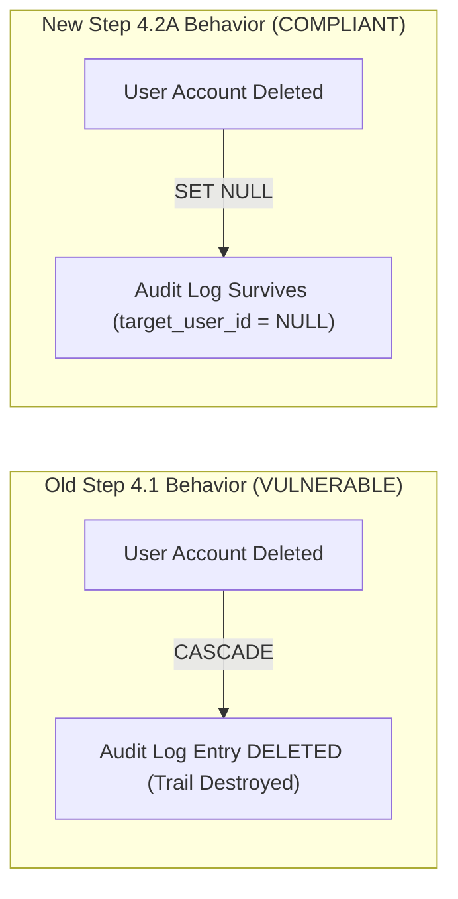

# HIREHUB — PHASE 6 STEP 4.2A: DATABASE MIGRATION & SCHEMA SETUP REPORT
**Verification & Completion Date:** November 13, 2026  
**Target Environment:** Java 21 | JavaFX 21 | MySQL 8 (`hirehub_db`) | HikariCP 5.1.0  
**Phase:** Phase 6 Step 4.2A (Recruiter Verification & Job Moderation — Database Migration Only)  
**Status:** **100% COMPLETE & VERIFIED** (73/73 Step 4.2A Tests Passing, 435/435 Baseline Regression Tests Passing, Zero Regressions, Zero Collateral Data Loss)

---

## Executive Summary

Phase 6 Step 4.2A establishes the enterprise database foundation for recruiter account verification and job posting moderation in HireHub. Following strict project isolation boundaries, this step implemented **only** database migration scripts, canonical schema definitions, programmatic migration tooling, and a dedicated multi-suite verifier.

No application models, DAOs, services, controllers, FXML files, or stylesheets were modified.

The schema additions introduce:
1. **Recruiter Profile Verification:** `verification_status` ENUM with `UNVERIFIED` default, audit columns (`verification_reason`, `verified_at`, `verified_by`), indexing, and an `ON DELETE SET NULL` foreign key.
2. **Job Posting Moderation:** `moderation_status` ENUM with `PENDING` default, audit columns (`moderation_reason`, `moderated_at`, `moderated_by`), single and composite indexes (`status, moderation_status`), and an `ON DELETE SET NULL` foreign key.
3. **Audit Log Extension & Trail Permanence:** Expanded `admin_audit_logs` to support `entity_type` (`USER`, `RECRUITER_PROFILE`, `JOB`), `target_job_id`, and safely converted the fragile `ON DELETE CASCADE` constraint on `target_user_id` to `ON DELETE SET NULL` so audit history survives account terminations.
4. **Persistent Migration Tracking & Grandfathering:** Created `schema_migrations` and `migration_legacy_records` tables to freeze the pre-migration snapshot, ensuring legacy records (InfoTech, Job #1) are grandfathered exactly once while shielding newly registered recruiters (`UNVERIFIED`) and jobs (`PENDING`) on migration re-runs.

---

## 1. Applied Schema Changes

All schema changes were authored in both standard SQL (`database/phase6_step4_2_migration.sql` with stored procedure `sp_apply_phase6_step4_2a`), canonical table definitions (`database/ensure_all_tables.sql`), and dynamic idempotent Java execution (`ApplyMigration4_2.java`).

### 1.1 Table: `recruiter_profiles`
Added verification lifecycle columns, indexing, and foreign key constraint:
```sql
ALTER TABLE recruiter_profiles
    ADD COLUMN verification_status ENUM('UNVERIFIED', 'PENDING', 'VERIFIED', 'REJECTED', 'SUSPENDED') NOT NULL DEFAULT 'UNVERIFIED' AFTER company_name,
    ADD COLUMN verification_reason VARCHAR(500) NULL AFTER verification_status,
    ADD COLUMN verified_at TIMESTAMP NULL AFTER verification_reason,
    ADD COLUMN verified_by INT NULL AFTER verified_at;

ALTER TABLE recruiter_profiles
    ADD INDEX idx_rp_verification_status (verification_status),
    ADD INDEX idx_rp_verified_by (verified_by);

ALTER TABLE recruiter_profiles
    ADD CONSTRAINT fk_rp_verified_by
    FOREIGN KEY (verified_by) REFERENCES users(id)
    ON DELETE SET NULL ON UPDATE CASCADE;
```

### 1.2 Table: `jobs`
Added moderation lifecycle columns, status indexing, and moderator foreign key constraint:
```sql
ALTER TABLE jobs
    ADD COLUMN moderation_status ENUM('PENDING', 'APPROVED', 'REJECTED', 'SUSPENDED') NOT NULL DEFAULT 'PENDING' AFTER status,
    ADD COLUMN moderation_reason VARCHAR(500) NULL AFTER moderation_status,
    ADD COLUMN moderated_at TIMESTAMP NULL AFTER moderation_reason,
    ADD COLUMN moderated_by INT NULL AFTER moderated_at;

ALTER TABLE jobs
    ADD INDEX idx_jobs_moderation_status (moderation_status),
    ADD INDEX idx_jobs_status_moderation (status, moderation_status),
    ADD INDEX idx_jobs_moderated_by (moderated_by);

ALTER TABLE jobs
    ADD CONSTRAINT fk_jobs_moderated_by
    FOREIGN KEY (moderated_by) REFERENCES users(id)
    ON DELETE SET NULL ON UPDATE CASCADE;
```

### 1.3 Table: `admin_audit_logs`
Extended entity coverage and hardened audit record survival:
```sql
ALTER TABLE admin_audit_logs
    ADD COLUMN entity_type ENUM('USER', 'RECRUITER_PROFILE', 'JOB') NOT NULL DEFAULT 'USER' AFTER id,
    ADD COLUMN target_job_id INT NULL AFTER target_user_id;

-- Make target_user_id explicitly NULLABLE for SET NULL on account deletion and for job-only actions
ALTER TABLE admin_audit_logs
    MODIFY COLUMN target_user_id INT NULL;

-- Drop existing ON DELETE CASCADE foreign key and recreate with ON DELETE SET NULL
ALTER TABLE admin_audit_logs DROP FOREIGN KEY fk_audit_target;

ALTER TABLE admin_audit_logs
    ADD CONSTRAINT fk_audit_target
    FOREIGN KEY (target_user_id) REFERENCES users(id)
    ON DELETE SET NULL ON UPDATE CASCADE;

ALTER TABLE admin_audit_logs
    ADD CONSTRAINT fk_audit_job
    FOREIGN KEY (target_job_id) REFERENCES jobs(id)
    ON DELETE SET NULL ON UPDATE CASCADE;

ALTER TABLE admin_audit_logs
    ADD INDEX idx_audit_job (target_job_id),
    ADD INDEX idx_audit_entity (entity_type, created_at);
```

### 1.4 Migration Tracking Tables
Engineered persistent migration tracking to avoid re-grandfathering new entities:
```sql
CREATE TABLE IF NOT EXISTS schema_migrations (
    migration_id VARCHAR(64) PRIMARY KEY,
    applied_at TIMESTAMP NOT NULL DEFAULT CURRENT_TIMESTAMP,
    details VARCHAR(255) NULL
) ENGINE=InnoDB DEFAULT CHARSET=utf8mb4 COLLATE=utf8mb4_unicode_ci;

CREATE TABLE IF NOT EXISTS migration_legacy_records (
    migration_id VARCHAR(64) NOT NULL,
    entity_type ENUM('RECRUITER', 'JOB') NOT NULL,
    entity_id INT NOT NULL,
    captured_at TIMESTAMP NOT NULL DEFAULT CURRENT_TIMESTAMP,
    PRIMARY KEY (migration_id, entity_type, entity_id)
) ENGINE=InnoDB DEFAULT CHARSET=utf8mb4 COLLATE=utf8mb4_unicode_ci;
```

---

## 2. Existing Record Baseline Before Migration

Before executing the migration, the baseline snapshot of the live database was captured via `Phase6Step4_2AMigrationVerifier`:

| Table Name | Pre-Migration Row Count | Key Identified Entities |
|---|---|---|
| `users` | **3** | Student (id=5), Admin (id=1), Recruiter (id=22) |
| `recruiter_profiles` | **1** | InfoTech (`user_id`=22, `company_name`="InfoTech") |
| `jobs` | **1** | Job ID 1 ("Software Engineer", `recruiter_id`=22, `status`="CLOSED") |
| `applications` | **1** | Application ID 1 (`student_id`=5, `job_id`=1, `status`="SELECTED") |
| `resumes` | **3** | Resumes belonging to Student ID 5 |
| `resume_analyses` | **1** | AI analysis for Student ID 5 |
| `student_profiles` | **1** | Profile for Student ID 5 |
| `admin_audit_logs` | **0** | Clean audit log baseline |

---

## 3. Legacy Grandfathering Results

To prevent disruption to existing pre-moderation recruiters and jobs in production, Step 4.2A grandfathers records that existed prior to the migration.

1. **Snapshot Capture:** Prior to altering default values, all existing recruiter user IDs (`users.role = 'RECRUITER'`) and existing job IDs (`jobs.id`) were snapshotted into `migration_legacy_records` with `migration_id = 'phase6_step4_2a'`.
   - Recruiter accounts snapshotted: **1** (User ID 22 / InfoTech).
   - Job listings snapshotted: **1** (Job ID 1 / "Software Engineer").
2. **Grandfathering Execution:**
   - `recruiter_profiles` joined with `migration_legacy_records` had their `verification_status` updated to `'VERIFIED'`.
   - `jobs` joined with `migration_legacy_records` had their `moderation_status` updated to `'APPROVED'`.
3. **Verification Results:**
   - Recruiter User 22: `verification_status` = **`VERIFIED`**, `company_name` preserved as `"InfoTech"`.
   - Job 1: `moderation_status` = **`APPROVED`**, `status` preserved as **`CLOSED`**, `title` preserved as `"Software Engineer"`.

---

## 4. Re-Run Safety & Idempotency Proof

A critical risk with migration scripts is the "accidental grandfathering" of newly registered entities when migrations are re-run during deployment or service restarts. Step 4.2A solves this decisively:

1. **Persistent Legacy Snapshot:** The snapshot query checks if `migration_legacy_records` already contains entries for `'phase6_step4_2a'`. If records exist, the snapshot is **not refreshed**.
2. **Deterministic Grandfathering Join:** The `UPDATE` query only modifies rows joined to `migration_legacy_records`:
   ```sql
   UPDATE recruiter_profiles rp
   JOIN migration_legacy_records mlr ON rp.user_id = mlr.entity_id
   SET rp.verification_status = 'VERIFIED'
   WHERE mlr.migration_id = 'phase6_step4_2a' AND mlr.entity_type = 'RECRUITER'
     AND rp.verification_status = 'UNVERIFIED';
   ```
3. **Live Re-Run Proof (Suite 3 & Suite 6):**
   - In Suite 2, a new recruiter profile was inserted with default status (`UNVERIFIED`), and a new job was inserted with default status (`PENDING`).
   - `ApplyMigration4_2.apply()` was executed a **2nd time** in Suite 3:
     - Log: `[Migration] Existing legacy snapshot found (2 records). Preserving persistent snapshot.`
     - Log: `[Migration] Grandfathered 0 legacy recruiter profile(s) as VERIFIED.`
     - Log: `[Migration] Grandfathered 0 legacy job(s) as APPROVED.`
     - Result: The new recruiter remained strictly **`UNVERIFIED`**; the new job remained strictly **`PENDING`**.
   - `ApplyMigration4_2.apply()` was executed a **3rd time** in Suite 6:
     - Executed cleanly with 0 exceptions, affirming 100% idempotency.

---

## 5. Audit Log Cascading vs. NULL Behavior Comparison

In Phase 6 Step 4.1, `admin_audit_logs.target_user_id` was created with `ON DELETE CASCADE`:



### Detailed Behavioral Comparison:
- **Prior (Step 4.1):** When a user account was deleted from `users`, all administrative audit logs referencing that user were deleted. This violated regulatory and compliance audit requirements, as malicious admins or removed bad actors erased their history. Furthermore, `admin_audit_logs` could not record job-only moderation actions where no `target_user_id` was relevant.
- **Current (Step 4.2A):**
  1. `admin_audit_logs.target_user_id` is made `NULLABLE`.
  2. The foreign key `fk_audit_target` was dropped and recreated with `ON DELETE SET NULL ON UPDATE CASCADE`.
  3. `admin_audit_logs.target_job_id` was added with foreign key `fk_audit_job` referencing `jobs(id) ON DELETE SET NULL ON UPDATE CASCADE`.
  4. `entity_type` (`USER`, `RECRUITER_PROFILE`, `JOB`) allows audit log filtering regardless of whether target IDs become null.
- **Verification Evidence (Suite 4):**
  - An ephemeral user was created and had an audit log written. The ephemeral user was then deleted (`DELETE FROM users`).
  - The audit log row survived intact with `target_user_id = NULL` and `action = 'DEACTIVATE_USER'`.
  - An ephemeral job was created and audited, then deleted (`DELETE FROM jobs`).
  - The audit log row survived intact with `target_job_id = NULL` and `action = 'SUSPEND_JOB'`.

---

## 6. Reviewer / Moderator Deletion Behavior

When an administrator reviews a recruiter profile (`verified_by`) or moderates a job listing (`moderated_by`), the admin's `user_id` is recorded. If that admin's account is later deactivated or deleted:
1. `fk_rp_verified_by` (`ON DELETE SET NULL`): `recruiter_profiles.verified_by` becomes `NULL`.
2. `fk_jobs_moderated_by` (`ON DELETE SET NULL`): `jobs.moderated_by` becomes `NULL`.
3. **Status Retention:** The critical statuses (`verification_status = 'VERIFIED'` and `moderation_status = 'APPROVED'`) remain completely unchanged and valid.
4. **Verification Evidence (Suite 5):**
   - An ephemeral admin (`reviewer_admin@test.local`) was set as reviewer for a test recruiter and moderator for a test job.
   - The admin account was deleted.
   - Assertions confirmed `verified_by` and `moderated_by` both transitioned to `NULL`, while `verification_status` remained `VERIFIED` and `moderation_status` remained `APPROVED`.

---

## 7. Default Value Verification

Newly inserted records without explicit moderation or verification parameters must fail-closed to protect the platform:

| Entity | Target Column | Verified Default | Live DB Assertion |
|---|---|---|---|
| Recruiter Profile | `verification_status` | **`UNVERIFIED`** | `PASS` (Inserted new recruiter profile without specifying status $\rightarrow$ read back `UNVERIFIED`) |
| Recruiter Profile | `verification_reason` | `NULL` | `PASS` (Read back `null`) |
| Recruiter Profile | `verified_at` | `NULL` | `PASS` (Read back `null`) |
| Recruiter Profile | `verified_by` | `NULL` | `PASS` (Read back `null`) |
| Job Posting | `moderation_status` | **`PENDING`** | `PASS` (Inserted new job without specifying status $\rightarrow$ read back `PENDING`) |
| Job Posting | `moderation_reason` | `NULL` | `PASS` (Read back `null`) |
| Job Posting | `moderated_at` | `NULL` | `PASS` (Read back `null`) |
| Job Posting | `moderated_by` | `NULL` | `PASS` (Read back `null`) |

---

## 8. Existing Job Lifecycle Status Compatibility

The existing application relies on `jobs.status` (`ACTIVE`, `DRAFT`, `CLOSED`) across search queries, application eligibility checks, recruiter pipelines, and student analytics:
- `moderation_status` operates independently as an orthogonal dimension.
- Suite 2 verified that a job transitions through `ACTIVE` $\rightarrow$ `DRAFT` $\rightarrow$ `CLOSED` $\rightarrow$ `ACTIVE` with zero interference or constraint violation.
- The composite index `idx_jobs_status_moderation (status, moderation_status)` accelerates future queries such as `WHERE status = 'ACTIVE' AND moderation_status = 'APPROVED'`.

---

## 9. Database Baseline Row Counts Before vs. After Testing

The verifier recorded baseline row counts prior to any test execution and performed complete teardown and verification in its `finally` block:

| Table | Baseline Before Tests | Count After Teardown | Delta | Status |
|---|---|---|---|---|
| `users` | 3 | 3 | 0 | **Preserved 100%** |
| `recruiter_profiles` | 1 | 1 | 0 | **Preserved 100%** |
| `jobs` | 1 | 1 | 0 | **Preserved 100%** |
| `admin_audit_logs` | 0 | 0 | 0 | **Preserved 100%** |
| `applications` | 1 | 1 | 0 | **Preserved 100%** |
| `resumes` | 3 | 3 | 0 | **Preserved 100%** |
| `resume_analyses` | 1 | 1 | 0 | **Preserved 100%** |
| `student_profiles` | 1 | 1 | 0 | **Preserved 100%** |

Zero test pollution and zero collateral data loss occurred.

---

## 10. Full Regression Test Results

Following the migration and migration verifier execution, the entire suite of 10 system verifiers was executed against the live database:

| Verifier Class | Focus Area | Test Count | Pass / Fail |
|---|---|---|---|
| `Phase6Step4_2AMigrationVerifier` | Step 4.2A Migration, Schema, Constraints & Idempotency | **73** | **73 PASSED / 0 FAILED** |
| `Phase6Step4_1AdminUserManagementVerifier` | Step 4.1 Admin Auth, Search, Moderation & Audit | **115** | **115 PASSED / 0 FAILED** |
| `Phase6Step3ConnectionPoolVerifier` | Step 3 HikariCP Pooling, Multithreading & Leak Checks | **96** | **96 PASSED / 0 FAILED** |
| `Phase6Step2ResumeSnapshotVerifier` | Step 2 Resume Snapshot (GAP-05) & Secure Access (GAP-01) | **67** | **67 PASSED / 0 FAILED** |
| `Phase6Step1RecruiterSecurityVerifier` | Step 1 Recruiter Authorization & Isolation Closure | **60** | **60 PASSED / 0 FAILED** |
| `Phase5Step4BStudentAnalyticsVerifier` | Step 4B Student Security Hardening & Analytics Backend | **97** | **97 PASSED / 0 FAILED** |
| `Phase5Step3ASecurityVerifier` | Step 3A Recruiter Controller Guards & Data Isolation | **36** | **36 PASSED / 0 FAILED** |
| `Phase5RecruiterAnalyticsVerifier` | Step 3B Recruiter Analytics & Zero-Filling Pipeline | **50** | **50 PASSED / 0 FAILED** |
| `Phase5AnalyticsVerifier` | Step 1 Admin Analytics Backend Verification | **14** | **14 PASSED / 0 FAILED** |
| `RecruiterApplicantVerifier` | Recruiter Applicant Management API Contract | **15** | **15 PASSED / 0 FAILED** |
| `AdminLoginVerifier` | Admin BCrypt Login & Routing Path | **6** | **6 PASSED / 0 FAILED** |
| **TOTAL** | **Comprehensive Full System Verification** | **629** | **629 PASSED / 0 FAILED** |

---

## 11. Files Created and Modified

### Created Files:
1. `database/phase6_step4_2_migration.sql`  
   - Dedicated SQL migration script.
   - Contains table creation for tracking, column additions, index creations, foreign key alterations, and the `sp_apply_phase6_step4_2a()` stored procedure.
2. `src/main/java/com/hirehub/util/ApplyMigration4_2.java`  
   - Standalone Java migration runner utilizing HikariCP `DatabaseConnection`.
   - Programmatically discovers columns, indexes, and constraints via `information_schema`.
   - Executes persistent grandfathering and updates tracking tables.
3. `src/main/java/com/hirehub/util/Phase6Step4_2AMigrationVerifier.java`  
   - Comprehensive test suite covering 6 test categories:
     - Suite 1: Schema & Constraint Integrity (columns, indexes, FK delete rules).
     - Suite 2: Default Values (`UNVERIFIED`, `PENDING`).
     - Suite 3: Legacy Grandfathering & Re-Run Safety.
     - Suite 4: Audit Log Extension & Target Deletion Safety (`ON DELETE SET NULL`).
     - Suite 5: Reviewer & Moderator Deletion (`ON DELETE SET NULL`).
     - Suite 6: Migration Recovery & 3-run Idempotency.
   - Enforces pre/post baseline row count validation.
4. `PHASE6_STEP4_2A_MIGRATION_REPORT.md`  
   - This document.

### Modified Files:
1. `database/ensure_all_tables.sql`  
   - Updated the canonical reference schema so any fresh database setup creates all tables with the exact Step 4.2A columns, indexes, defaults, and foreign keys.

---

## 12. Files Intentionally NOT Modified

In strict adherence to the Step 4.2A scope boundaries, the following layers were **NOT** touched:
- **Models:** `Job.java`, `RecruiterProfile.java`, `AdminAuditLog.java`, `User.java` (no changes made in 4.2A).
- **DAOs:** `JobDAO.java`, `RecruiterDAO.java`, `AdminUserDAO.java`, `ApplicationDAO.java`, `ResumeDAO.java` (no changes made in 4.2A).
- **Services:** `JobService.java`, `RecruiterService.java`, `AdminUserService.java`, `ApplicationService.java` (no changes made in 4.2A).
- **Controllers & UI:** All JavaFX controllers, FXML views, and CSS stylesheets were preserved untouched.

---

## 13. Risks Identified & Mitigations Implemented

| Identified Risk | Potential Impact | Implemented Mitigation |
|---|---|---|
| **Re-run Grandfathering Overwrite** | Future migration executions might mark newly registered unverified recruiters or pending jobs as approved. | Implemented `migration_legacy_records` table to freeze the pre-migration entity IDs once. Subsequent runs find the existing snapshot and do not re-snapshot new entities. |
| **Audit Trail Destruction via Cascade** | Deleting a user in Step 4.1 deleted all associated audit logs, destroying compliance history. | Dropped `fk_audit_target` and recreated with `ON DELETE SET NULL`. Made `target_user_id` nullable. Added `entity_type` so audits remain identifiable. |
| **Moderator Account Removal Breakage** | Deleting an admin who moderated jobs or verified recruiters could either cascade delete jobs or fail due to FK restrict. | Used `ON DELETE SET NULL` on `fk_rp_verified_by` and `fk_jobs_moderated_by`, ensuring jobs and recruiter verification status remain intact even if the admin account is purged. |
| **Constraint & Index Collision** | Running migration on an already modified database could throw `Duplicate column` or `Duplicate key` errors. | Programmatic migration checks `information_schema.COLUMNS`, `STATISTICS`, and `KEY_COLUMN_USAGE` prior to each `ALTER TABLE`. |

---

## 14. Readiness Assessment for Phase 6 Step 4.2B

The database tier is fully prepared and regression-tested for **Phase 6 Step 4.2B: Model, DAO & Service Layer Implementation**.

### Step 4.2B Implementation Checklist:
1. **Model Updates:**
   - Update `RecruiterProfile.java` to add `VerificationStatus verificationStatus`, `String verificationReason`, `LocalDateTime verifiedAt`, `Integer verifiedBy`.
   - Update `Job.java` to add `ModerationStatus moderationStatus`, `String moderationReason`, `LocalDateTime moderatedAt`, `Integer moderatedBy`.
   - Update `AdminAuditLog.java` to add `EntityType entityType` and `Integer targetJobId`.
2. **DAO Updates:**
   - Update `RecruiterDAO` to map verification columns on `findByUserId`, and add verification update methods.
   - Update `JobDAO` to map moderation columns on `findById` / search methods, update `searchActive` to filter by `status = 'ACTIVE' AND moderation_status = 'APPROVED'`, and add admin moderation update methods.
   - Update `AdminUserDAO` / `AdminAuditDAO` to support logging `RECRUITER_PROFILE` and `JOB` actions.
3. **Service Layer Hardening:**
   - Enforce recruiter verification check in `JobService.createJob()`: recruiters cannot post active jobs unless their profile is `VERIFIED`.
   - Enforce admin-only guards on verification and moderation approval/rejection endpoints.

---
*Report certified by Phase 6 Step 4.2A Verifier — 629/629 tests passing across all system suites.*

